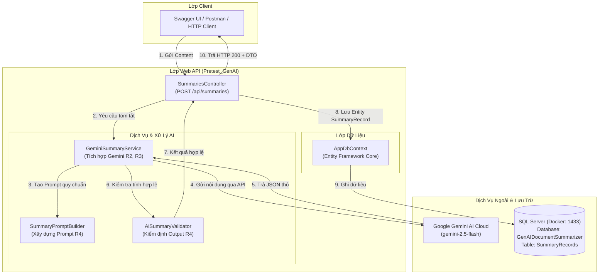
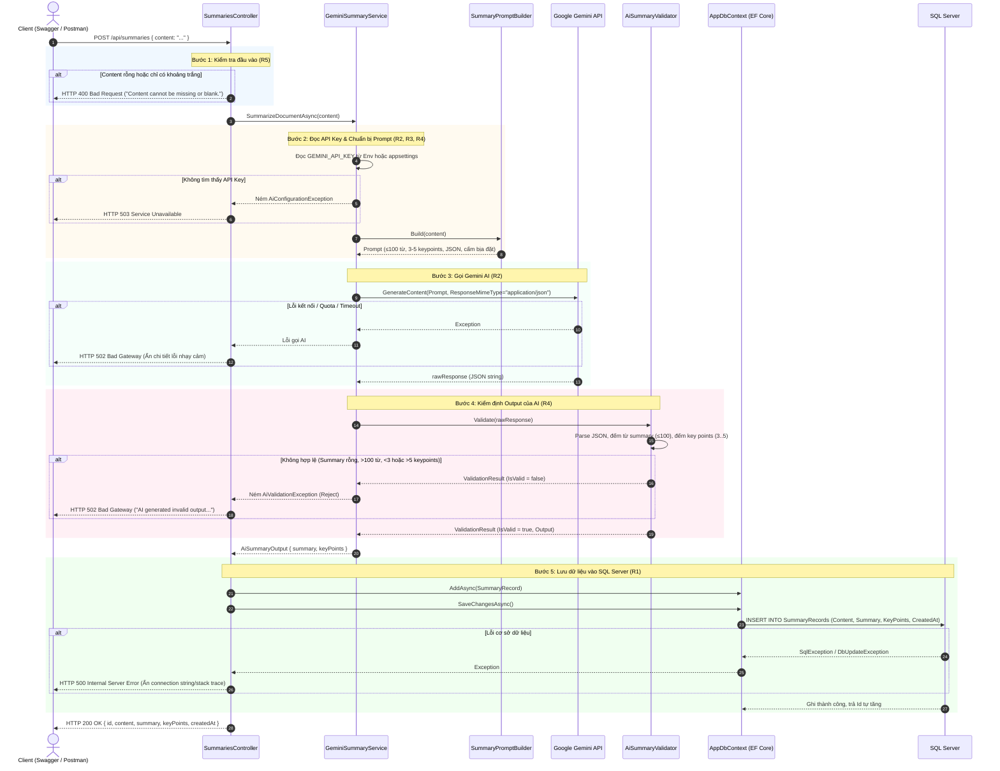
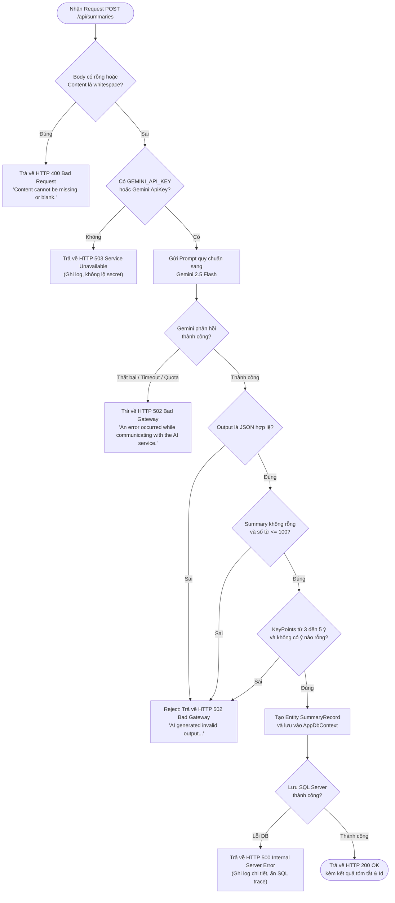
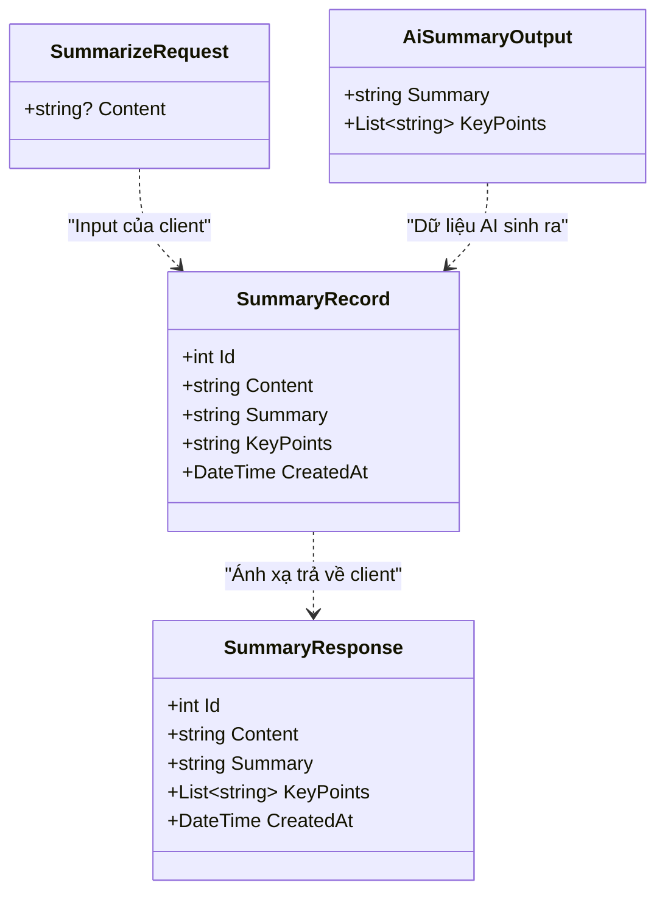

# Luồng Hoạt Động Hệ Thống GenAI Document Summarizer

Tài liệu mô tả chi tiết kiến trúc, sơ đồ tuần tự và luồng xử lý của hệ thống **GenAI Document Summarizer** theo các yêu cầu từ **R1 đến R5** trong đề bài Pretest.

---

## 1. Kiến trúc Tổng thể Hệ thống

---

## 2. Sơ đồ Tuần tự (Sequence Diagram)

Mô tả luồng giao tiếp giữa các thành phần từ khi Client gửi request đến khi lưu dữ liệu thành công hoặc bắt lỗi.

---

## 3. Sơ đồ Luồng Quyết định Chi tiết (Decision Flowchart)

---

## 4. Mô hình Dữ liệu (Entity & DTO)

---

## 5. Bảng Mã Lỗi và Xử Lý An Toàn (R5)

| Mã HTTP | Tình huống | Thông điệp trả về Client | Xử lý nội bộ (Server) |
| :--- | :--- | :--- | :--- |
| **`200 OK`** | Xử lý thành công toàn bộ luồng | JSON chứa `id`, `content`, `summary`, `keyPoints`, `createdAt` | Ghi log thông tin tóm tắt và thời gian xử lý. |
| **`400 Bad Request`** | Nội dung bị thiếu, chuỗi rỗng hoặc chỉ có khoảng trắng | `{"error": "Content cannot be missing or blank."}` | Không gọi AI, không lưu DB, tiết kiệm chi phí/quota. |
| **`502 Bad Gateway`** | Gemini gặp lỗi mạng/quota HOẶC output của AI vi phạm quy tắc validation (R4) | `{"error": "AI generated invalid output that does not meet the summarization rules."}` | Ghi log chi tiết chuỗi AI trả về để debug; **không lưu DB**. |
| **`503 Service Unavailable`** | Thiếu cấu hình API Key của Gemini | `{"error": "AI service is currently not configured or unavailable."}` | Ghi log cảnh báo thiếu key, hướng dẫn kiểm tra cấu hình. |
| **`500 Internal Server Error`** | Lỗi kết nối hoặc ghi cơ sở dữ liệu SQL Server | `{"error": "A database error occurred while saving the summary record."}` | Ghi log chi tiết Exception, ẩn connection string và stack trace. |
